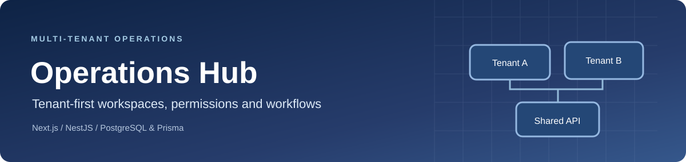
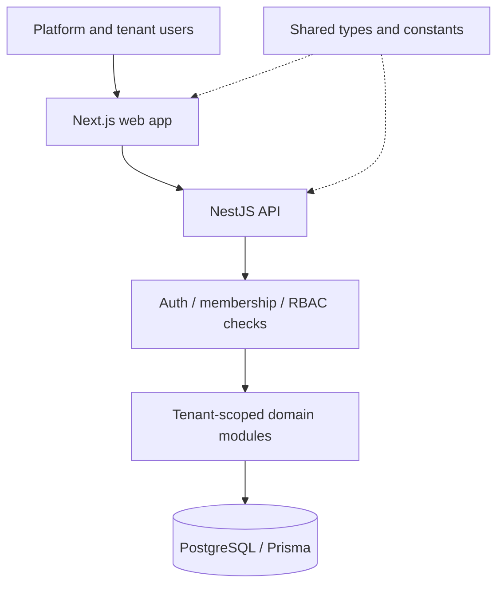
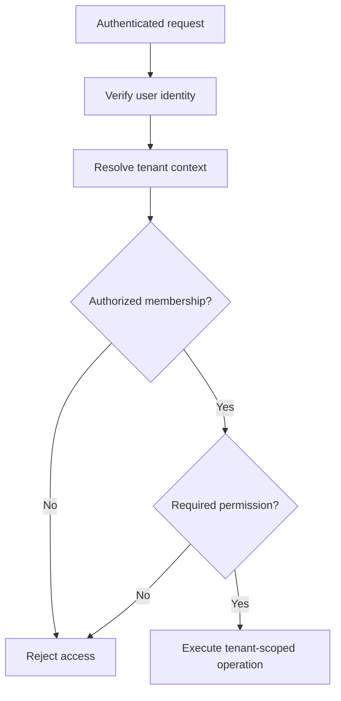

<p align="center"></p>

<h1 align="center">Operations Hub</h1>
<p align="center"><strong>Tenant-first organizational operations platform</strong></p>
<p align="center">
  
  
  
</p>
<p align="center">
  <a href="#platform-overview">Overview</a> · <a href="#system-architecture">Architecture</a> ·
  <a href="#getting-started">Quick start</a> · <a href="docs/Operations_Hub_21UC_MD_v4/00_Use_Case_Tong_Quat.md">Use-case catalog</a> ·
  <a href="docs/public-pages-minimalist-ui.md">UI specification</a>
</p>

Operations Hub is an engineering prototype of a **multi-tenant operations management platform**. It separates platform-level identities from tenant membership and permissions while organizing work through modular use cases. The 21-group use-case catalog is a **requirements baseline**, not a claim that all 21 groups are implemented end-to-end.

## Platform overview

| | Area | Scope |
| :--: | --- | --- |
|  | **Tenant management** | Platform and organization boundaries, tenant-scoped records |
|  | **Identity and RBAC** | Authentication, membership and tenant-scoped permissions |
|  | **Operations modules** | Requests, teams, meetings, documents, finance and reporting as implemented or specified |

## System architecture





These are **logical diagrams**, not verified production network architecture or an authorization audit. Consult the API's current guards, Prisma schema and active routes for implementation behavior.

### Repository layout

| Path | Responsibility |
| --- | --- |
| `apps/web` | Next.js frontend and public experience |
| `apps/api` | NestJS domain API, auth and Prisma integration |
| `packages/shared` | Cross-package types and constants |
| `docs/` | Use-case specifications, diagrams and design notes |
| `artifacts/` | Versioned technical/test snapshots |

## Getting started

Prerequisites: Node.js, **pnpm 11.7.0**, Docker and PostgreSQL. From repository root:

```bash
cp .env.example .env
cp apps/api/.env.example apps/api/.env
docker compose up -d
pnpm install
pnpm db:generate
pnpm db:migrate
pnpm db:seed
pnpm dev
```

PowerShell uses `Copy-Item` instead of `cp` if needed. Keep local environment files ignored. Change example database credentials and JWT secrets before using any shared host.

| Local service | URL |
| --- | --- |
| Web | `http://localhost:3000` |
| API | `http://localhost:3001` |
| Swagger | `http://localhost:3001/api/docs` |

### Demo dataset

For **isolated local development only**, use `pnpm db:seed` or `pnpm mock:data`. The seed script creates predetermined test accounts, including privileged roles, with a shared demonstration password. **Do not run this seed against an internet-accessible or real-user database.** The example credentials and seed defaults are not safe production identity settings.

## Development checks

```bash
pnpm lint
pnpm test
pnpm build
```

These commands are available scripts, not evidence that current CI passes.

## Documentation

- [21-group use-case catalog (requirements scope)](docs/Operations_Hub_21UC_MD_v4/00_Use_Case_Tong_Quat.md)
- [Class diagrams](docs/Operations_Hub_Class_Diagrams/README.md)
- [Public pages and minimalist UI specification](docs/public-pages-minimalist-ui.md)

**Public repository caution:** Architecture documentation may describe unreleased plans. Any real organizational data, secrets, tenant configuration, live credentials and partner documents must stay out of public Git history. No software license is declared at the repository root; public visibility does not itself grant unrestricted reuse rights.
